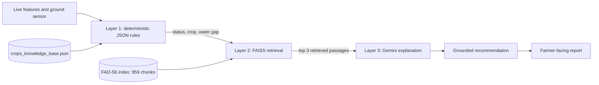

<div align="center">
  
  <h1>Field Shift: From Space to Roots</h1>
  <p><strong>A Zero-Hallucination Digital Twin &amp; Hybrid AI System Saving Smart Agriculture</strong></p>
  <p>
    
    
    
    
  </p>
</div>

Field Shift connects satellite-informed crop-water estimates with a ground sensor reading. A deterministic rules layer selects a crop recommendation, then a FAISS retriever supplies FAO-56 context for a concise explanation.

> **Scope note:** Metrics and the Agri_Point_73 scenario below describe the project’s reported benchmark and an illustrative threshold example. The running app computes its own baseline for the selected coordinate and uses the moisture value set in the sidebar; it does not hardcode the example values.

## Contents

- [The Problem and Mission](#the-problem-and-mission)
- [Multi-Source Data Architecture](#multi-source-data-architecture)
- [Model Benchmark and Spatial Validation](#model-benchmark-and-spatial-validation)
- [Decision Pipeline](#3-layer-grounded-decision-pipeline)
- [Early-Warning Scenario](#live-early-warning-scenario-agri_point_73)
- [Quickstart](#quickstart)
- [Repository Layout](#repository-layout)
- [Limitations](#limitations)

## The Problem and Mission

Irrigation decisions are often made with limited field observations. Blind irrigation wastes water, while climate volatility makes historical schedules less reliable. At the same time, a general-purpose language model can produce plausible agricultural advice that is not supported by agronomic evidence.

Field Shift is designed as a small decision-support system for that gap:

- Estimate a target root-zone moisture from engineered weather, vegetation, land-surface-temperature, and soil features using CatBoost.
- Compare that estimate with a ground moisture reading and apply explicit water-gap rules.
- Retrieve relevant FAO-56 material before generating an explanation, rather than asking a language model to invent the agronomy.

The interface is a Streamlit mission-control dashboard with a Folium coordinate selector, NASA POWER and SoilGrids live requests, and a bilingual English/Arabic result view.

## Multi-Source Data Architecture

The collection notebook samples 150 points from ESA WorldCover cropland class 40 inside Egypt. Its requested daily period, 2025-01-01 through 2026-10-31 inclusive, is 669 days. At full coverage, that corresponds to 150 × 669 = 100,350 location-day rows. The notebook skips failed source requests, so this is the target volume for a complete run, not a guarantee that every execution yields every row. The generated CSVs are written to Google Drive by the notebook and are not included in this repository.

| Source | Project / training use | Current Streamlit scan |
| --- | --- | --- |
| NASA POWER API | Daily meteorology and root-zone moisture target fields, including T2M, RH2M, precipitation, and GWETROOT | Requests T2M, RH2M, and PRECTOTCORR for the selected point and a recent date |
| NASA SMAP | Intended satellite soil-moisture cross-check for the space-to-ground concept | Not currently queried by `app.py` |
| MODIS via Google Earth Engine | Collection notebook derives NDVI from MOD13Q1 and land-surface temperature from MOD11A1 | Not queried by the Streamlit scan; the current live path derives its NDVI/LST inputs from soil texture and POWER temperature |
| ISRIC SoilGrids | Sand and clay percentages at 0–5 cm for the training features | Requests sand and clay at 0–5 cm for the selected point |

Earth Engine collection and training notebooks require their own Google Earth Engine authentication and Google Drive paths. The current web app does not run those notebook collection calls.

## Model Benchmark and Spatial Validation

The training notebook groups samples by `Location_Name` and uses five-fold `GroupKFold`, keeping each location out of its corresponding validation fold. The project’s reported benchmark is:

| Model | Reported RMSE | Selection |
| --- | ---: | --- |
| XGBoost | 0.0685 | Benchmark |
| LightGBM | 0.0666 | Benchmark |
| CatBoost | **0.0648** | Selected for the deployed inference path |

Lower RMSE is better. The reported values are the project benchmark figures; the notebook source contains the evaluation code but does not store a committed run-output report. The serialized CatBoost model used by the app is `models/Field_Shift_CatBoost_Final.cbm`.

## 3-Layer Zero-Hallucination Decision Pipeline



1. **Deterministic decision:** `core/rule_engine.py` compares the CatBoost baseline with the sensor. A difference greater than `0.10` is severe water stress; below `-0.10` is over-irrigation; otherwise the state is optimal. Crop options come from `data/crops_knowledge_base.json`.
2. **Scientific retrieval:** `core/rag_agent.py` loads the local FAISS index, built from FAO-56 source material with 1,000-character chunks and 200-character overlap. The checked-in index contains 959 vectors and retrieves the top three matches for a query.
3. **Grounded explanation:** Gemini 3.1 Flash-Lite is attempted first, with Gemini 1.5 Flash and Pro fallbacks. The prompt instructs the model to use only retrieved FAO-56 context. This is a grounding guardrail, not a formal guarantee that a generative model can never produce an unsupported statement.

## Live Early-Warning Scenario: Agri_Point_73

The following illustrative values show how the existing threshold behaves; they are not a persisted field measurement:

| Signal | Example |
| --- | ---: |
| AI space baseline | 35% |
| Ground IoT sensor | 20% |
| Ground minus baseline | **-15 percentage points** |
| Rule-engine gap (`baseline - sensor`) | **+15 percentage points** |
| Result | Severe water stress; gap exceeds the +10-point threshold |

The notebook generates coordinate names such as `Agri_Point_73`, but its IoT simulation samples a row at runtime and subtracts 0.12 from that row’s prediction. The 35%/20% values above are a clear demo scenario, not a claim that the notebook persists a particular Agri_Point_73 observation. In the web app, choose the map point and set the sensor slider to test the rule with the model’s actual prediction.

## Quickstart

### Requirements

- Python 3.10 or later is recommended.
- A valid Google Gemini API key is needed for generated explanations.
- The CatBoost model, crop knowledge base, and FAISS index are included in this repository.

### Install and run

```powershell
git clone https://github.com/GoldenBoy13420/-Field-Shift.git
Set-Location -LiteralPath '.\-Field-Shift'
py -m venv .venv
.\.venv\Scripts\Activate.ps1
python -m pip install -r requirements.txt
streamlit run app.py
```

The Streamlit app currently initializes Gemini with a key constant in `app.py`. Configure your own valid key there before running, and do not commit credentials. The app’s NASA POWER and SoilGrids requests do not require a separate key in the current implementation.

The app starts with Cairo-language selection and a default Cairo, Egypt coordinate. Use the map to select a point, adjust the ground-moisture slider, and run a scan. The live scan requests a recent NASA POWER day and SoilGrids soil texture; the CatBoost model and RAG pipeline then produce the diagnosis and explanation.

## Repository Layout

```text
-Field-Shift/
├── .streamlit/
│   └── config.toml                  # Enables local static image serving
├── app.py                           # Streamlit dashboard and live scan flow
├── assets/
│   ├── nasa-astronaut-hero.jpg       # Original-resolution hero photograph
│   └── space-pattern-bg.jpg          # Original-resolution repeating texture
├── static/                          # Optimized Streamlit-served copies
│   ├── nasa-astronaut-hero.jpg
│   └── space-pattern-bg.jpg
├── core/
│   ├── controller.py
│   ├── data_processor.py
│   ├── ml_engine.py
│   ├── rag_agent.py
│   └── rule_engine.py
├── data/
│   ├── crops_knowledge_base.json
│   └── faiss_index_real/
├── models/
│   └── Field_Shift_CatBoost_Final.cbm
├── notebooks/                       # Collection, engineering, training, RAG demos
├── requirements.txt
└── build_real_vector_db.py
```

## Limitations

- The current web scan calls NASA POWER and SoilGrids. SMAP and MODIS are project data pillars, but are not live inputs in `app.py`.
- The current app approximates NDVI from clay content and LST from POWER temperature; it does not invoke Earth Engine or fetch MODIS during a scan.
- The 100,350-row count assumes complete retrieval across the requested 669 days. The source CSV is produced by notebook workflows and is not checked in.
- Gemini is prompted to ground its answer in retrieved FAO-56 text; the deterministic rule layer controls the status and crop selection, but an LLM explanation should not be treated as a formal zero-hallucination guarantee.
